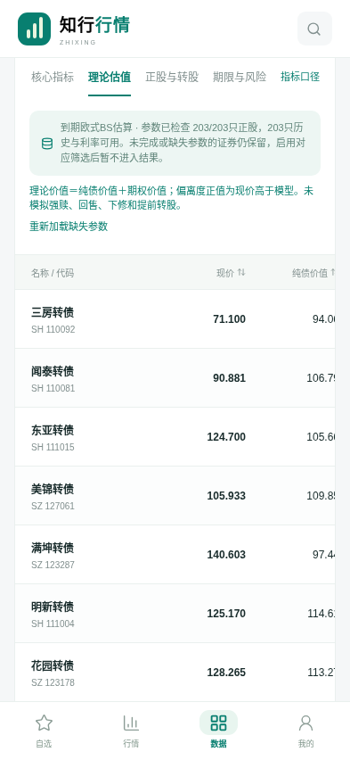
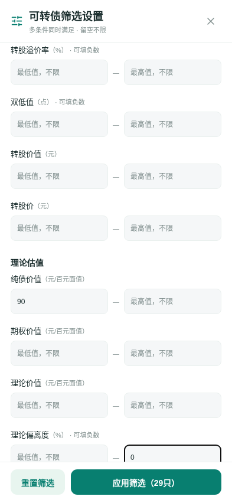
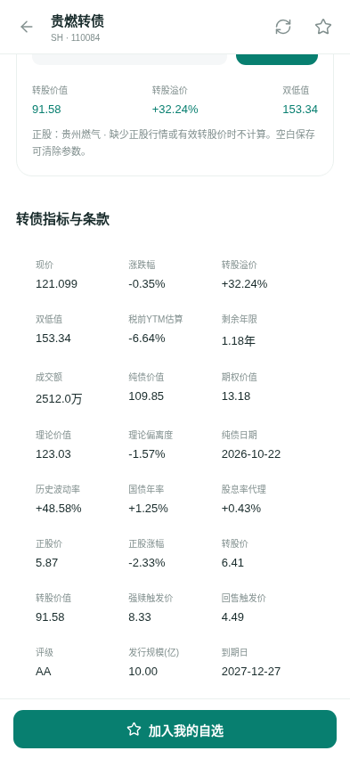
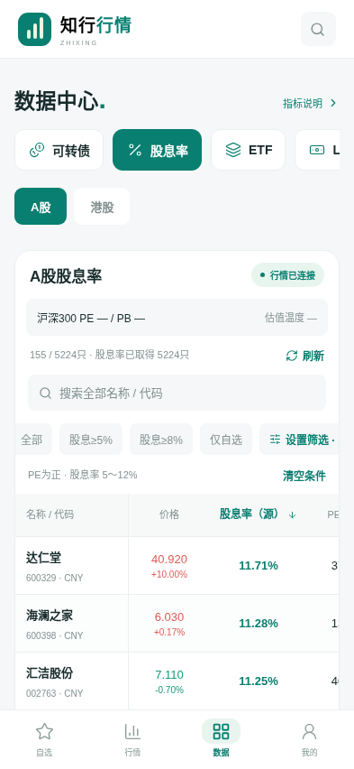
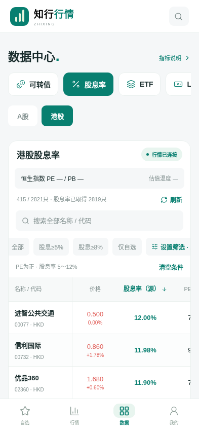
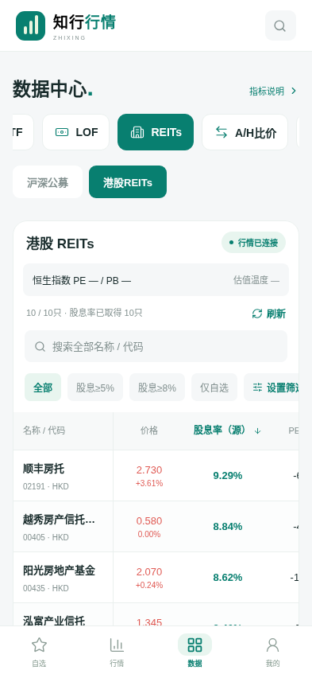
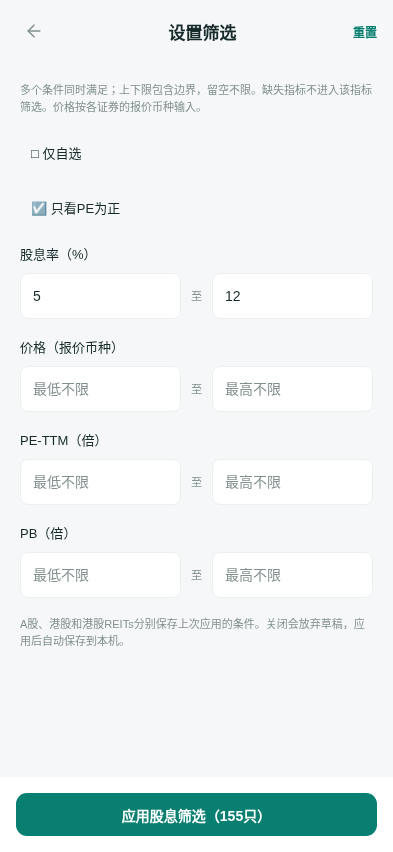
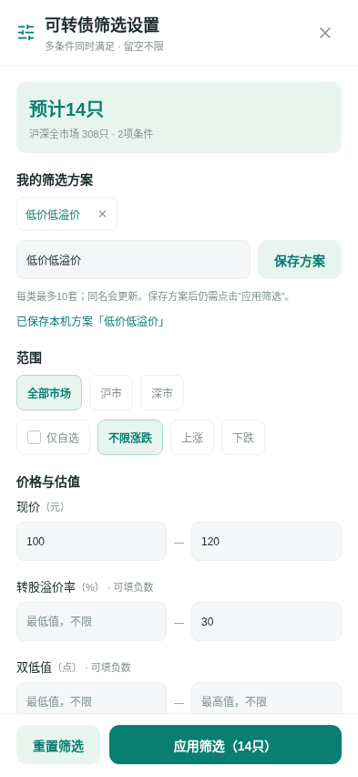
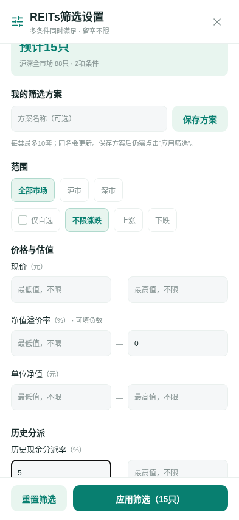

# 手机界面预览

这些是实际应用在手机尺寸下的浏览器截图，使用真实源响应快照。v1.4.0转债估值截图来自2026-10-23的311只转债、308条纯债估值、203套正股参数；其余截图来自2026-10-19验证：308只转债、88只沪深公募REITs及其披露净值和现金分红，以及5224只A股、港股公司目录和10只港股REITs的报价。用于查看布局，不代表 Android 真机安装测试；截图中的报价不是持续更新的实时行情。

v1.4.0新增纯债价值、期权价值、理论价值和理论偏离度，支持排序、组合筛选与详情参数说明。欧式估值不等同集思录模型；纯债与国债为2026-10-22日终数据，报价保留2026-10-23源时间。

v1.3.0 新增股息率与港股REITs。以下A股、港股示例应用「股息率5%～12%、PE为正」条件；五年均值、温度等未核验指标保持“—”。名单与符合数量会随数据变化。

v1.2.0新增组合筛选、上下限、结果预览和本机方案。以下筛选示例使用真实响应快照，实际符合数量会随数据变化。

数据表可横向滑动查看更多指标，支持全部品种排序、搜索和分页。手机数据页直接展示数据列表。
